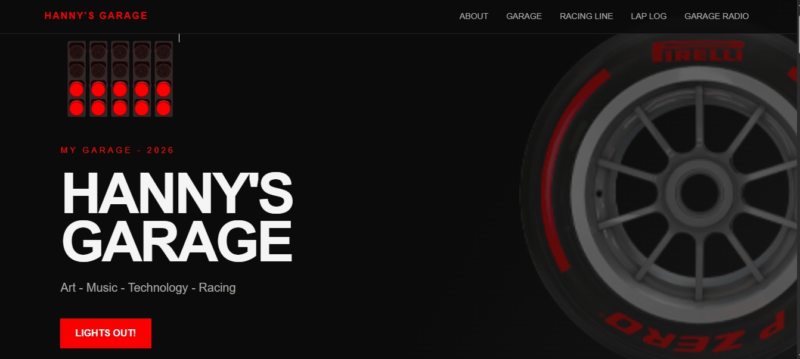

# Hanny's Garage
A personal website with a Formula 1 theme: about me, my projects, the things
I love, a small blog and the songs playing in my garage.



**Visit the site** [Open Hanny's Garage](https://hannyd9.github.io/Personal-Blog/)

## Quick Start
Open the link above. No install needed.

## Features
- F1 starting lights and a tyre in the hero section.
- Checkered flag strips between sections.
- "Things I love" cards that open to show a photo and text (only one open at a time)
- A blog called Lap Log with my progress updates.
- Garage Radio: songs shown with Formula 1 tyre compounds (soft, medium, hard, intermediate, wet)
- Responsive layout for phones and small screens.

## Run it locally
Requirements: a browser and VS Code with the Live Server extension (optional).

```
git clone https://github.com/hannyd9/Personal-Blog/
cd Personal-Blog
```

Open `index.html` in your browser, or right-click it in VS Code and choose **Open with Live Server**.

## How it works
The site uses only HTML and CSS, with no JavaScript. The "Things I love" cards use the `<details>` and `<summary>` elements, so they open and close without any script, and the `name` attribute makes sure only one stays open at a time. The checkered strips are one small image repeated with `background-repeat`.

I built it as a practice project to learn how GitHub and GitHub Pages work.

## Built with
- HTML and CSS in Visual Studio Code
- Images: from Google, Pinterest and Pirelli